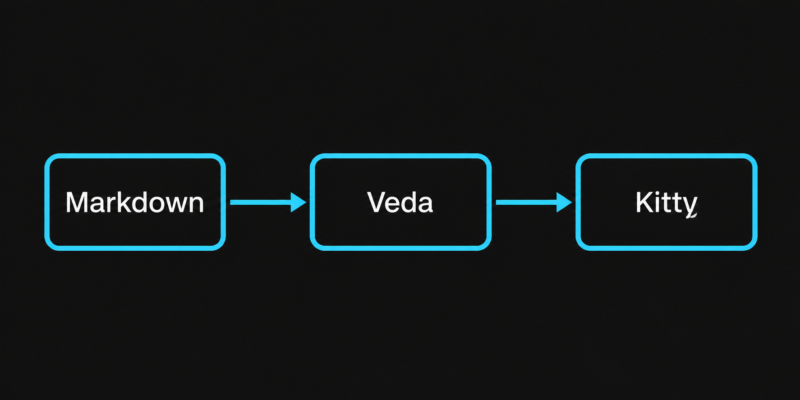

# Kitty image test

This paragraph contains **bold text** and a [link](https://example.com).

In normal mode, the PNG below should replace its Markdown source line. In insert
mode, the full `` syntax should appear again.

This text should appear below the image.
